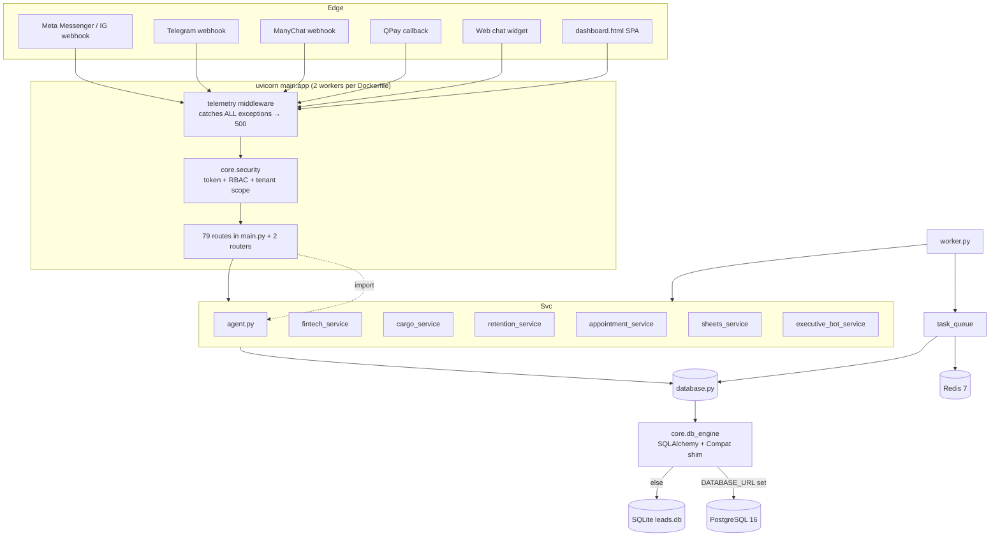

# ARCHITECTURE MAP — Actual vs. Target

Derived from reading the code at `48e9c6f`. Line references are from that commit.

---

## 1. Repository layout (actual)

```
gerege-ai-agent/
├── main.py                 2,260 LOC   FastAPI app: 79 routes, auth, webhooks, HTML routes
├── database.py             2,532 LOC   Raw DB-API data access + DDL (init_db) + 60+ helpers
├── dashboard.html          5,498 LOC   Entire SPA (admin, tenant portal, simulator) in one file
├── agent.py                  804 LOC   Gemini client, tool definitions, system prompt, memory
├── fintech_service.py        678 LOC   QPay v2, invoices, e-Barimt
├── core/
│   ├── security.py           453 LOC   RBAC matrix, token extraction, webhook signatures
│   ├── db_engine.py          448 LOC   SQLAlchemy engine + SQLite→PG compat shim
│   ├── task_queue.py         558 LOC   Redis/DB-backed job queue, atomic claim, DLQ
│   ├── backup_service.py     641 LOC   pg_dump/psql + SQLite backup, SHA-256 manifests
│   ├── ai_router.py          402 LOC   Injection detection, circuit breaker, retries, fallback
│   ├── models.py             357 LOC   SQLAlchemy declarative models (Alembic target)
│   └── monitoring.py         134 LOC   In-memory telemetry
├── routers/                  282 LOC   system_router (health/ready/metrics), automation_router
├── cargo_service.py          249 LOC   Cargo tracking
├── retention_service.py      204 LOC   Follow-up / retention campaigns
├── appointment_service.py    156 LOC   Booking
├── executive_bot_service.py  189 LOC   Daily Telegram report
├── sheets_service.py         397 LOC   Google Sheets sync
├── worker.py                 159 LOC   Background worker loop
├── widget.js                 301 LOC   Embeddable web chat
├── migrations/versions/0001_initial_enterprise_schema.py   354 LOC
├── scripts/                  migrate_sqlite_to_postgres.py (639), deploy.sh, rollback.sh
├── tests/                    1,938 LOC   10 files, 93 tests
├── scratch/                  **** NOT in CI, ad-hoc e2e scripts
└── docs/                     audit, architecture, ci, database, deployment, operations, security, testing
```

### Size concentration (risk)

| File | LOC | Share of Python | Concern |
|---|---|---|---|
| `database.py` | 2,532 | 15.8 % | DDL + I/O + domain rules + crypto helpers in one module |
| `main.py` | 2,260 | 14.1 % | 79 routes + helpers + middleware + HTML rendering |
| `dashboard.html` | 5,498 | — | Single-file UI; no build, no component reuse, 118 inline `onclick` |
| Top 3 | 10,290 | 64 % | |

---

## 2. Runtime topology (verified)



### Verified facts

- **Two schema sources of truth.** `database.init_db()` (raw `CREATE TABLE`, lines 62–360) is executed at
  **import time** (`main.py:36`). Alembic `0001` is a *separate* definition. They disagree
  (see `P1-02`).
- **Compat shim.** `core/db_engine.py` exposes a `sqlite3`-shaped API over psycopg2
  (`PostgresCompatConnection`/`Cursor`), translating `?`→`%s`, `INSERT OR IGNORE`→`ON CONFLICT`,
  `PRAGMA`→`SELECT 1`, and appending `RETURNING id`. It translates **SQL text** and **rows**, but not
  **types** — the source of `P0-01`.
- **Layering inversion.** `fintech_service`, `cargo_service`, `worker` import `main` for
  `send_meta_message` / `send_telegram_message` (deferred imports at call sites, so no hard cycle, but the
  dependency direction is wrong).
- **Exception masking.** The `http` middleware (`main.py:103-127`) converts every unhandled exception into
  `{"detail":"Internal server error"}` and logs `str(exc)` only. Tracebacks never reach the response or a
  structured log, which is why `P0-01` looked like an unexplained 500.

---

## 3. Data model (18 tables)

| Domain | Tables |
|---|---|
| Tenancy / auth | `pages`, `sessions`, `user_memories` |
| CRM | `registrations` (leads), `session_states` |
| Conversation | `messages` |
| Commerce | `invoices`, `cargo_packages` |
| Automation | `automated_rules`, `sent_followups`, `comment_automations`, `tracked_links` |
| Scheduling | `appointments` |
| Reliability | `task_jobs`, `notification_locks`, `audit_logs` |
| Marketing | `marketing_campaigns` |
| Alembic | `alembic_version` |

`page_id` is the tenant key on every table. Primary keys verified identical between Alembic and runtime
(17/17). **Indexes differ** (53 in Alembic vs 44 at runtime; Alembic additionally has
`idx_invoices_page_status`, `idx_messages_page_sender`, `idx_session_states_page_updated`,
`ix_pages_client_username`, `ix_pages_client_magic_token`, `ix_sessions_page_id`, `idx_user_memories_lookup`).

---

## 4. Request lifecycle (auth)

```
Authorization: Bearer <t> | cookie session_token | ?token=/?client_token=
        ↓  main.get_current_user (main.py:217)
database.get_session(t)                      → session row (role, page_id, expires_at)
        ↓ if miss
database.authenticate_client(t)              → magic-token → SYNTHESISES a session
        ↓
route handler → core_security.enforce_tenant_scope / require_user / resolve_current_user
```

**Observation:** three parallel token-extraction implementations exist —
`main.get_current_user` (main.py:217), `core_security.extract_token_from_request` (security.py:228) and
`core_security.resolve_current_user` (security.py:272). They agree today by inspection but are a
divergence hazard (`TD-04`).

Query-parameter tokens (`?token=`) are accepted; `is_query_token_allowed()` gates this by env.

---

## 5. Target architecture

Principles: **one schema authority**, **typed boundaries**, **no service→app imports**, **thin routes**.

```
app/
├── api/            FastAPI routers only — parse, authorise, delegate, serialise. No SQL.
│   ├── auth.py  conversations.py  crm.py  fintech.py  cargo.py
│   ├── automations.py  analytics.py  admin.py  webhooks/{meta,telegram,manychat,qpay}.py
│   └── deps.py     get_current_user, require_permission, tenant_scope
├── domain/         Pure rules: pricing, lead status FSM, workflow transitions, ROI formulas
├── services/       Orchestration: messaging, ai, crm, automation, analytics
├── integrations/   Adapters behind interfaces
│   ├── ai/{base.py, gemini.py, openai_compat.py, anthropic.py}
│   └── messaging/{base.py, meta.py, telegram.py, webchat.py}
├── repositories/   All SQL. One file per aggregate. Returns typed DTOs.
├── db/
│   ├── schema.py   **single** declarative metadata (Alembic is generated from it)
│   ├── engine.py   pool, session/transaction, compat layer (deleted once typed)
│   └── migrations/ (Alembic only)
└── core/           config (pydantic-settings), security, queue, backup, telemetry
```

### Non-negotiable target invariants

1. `init_db()` is **deleted**. Schema comes from Alembic only; app boot runs `alembic upgrade head` or
   refuses to start (`ALEMBIC_STRICT=1`).
2. Alembic `0001` is **rewritten** to emit the same column types as `core/models.py` (`DateTime`, not
   `String(64)`); a `compare_metadata` test asserts zero diff against a live PG.
3. Repositories return `datetime` objects; the API layer serialises through one Pydantic `response_model`
   — no raw `JSONResponse(dict)` with DB rows.
4. `services`/`integrations` never import `app`/`main`. Notification sends move to
   `integrations/messaging`.
5. `_SERIAL_ID_TABLES` disappears: inserts return `RETURNING *` via the repository.

### Migration path (ordered, low-risk)

| Step | Change | Backwards compatible? |
|---|---|---|
| 1 | Add `app/db/schema_guard.py` exposing `compare_metadata()`; wire into CI as **failing** gate | yes (additive) |
| 2 | Fix `P0-01` with a JSON serialiser at the API boundary (no schema change) | yes |
| 3 | Fix `P1-01` (`RETURNING` for all id tables), `P1-03` (range predicates instead of `LIKE`) | yes |
| 4 | Rewrite Alembic `0001` types; add `0002` that `ALTER`s an existing DB to `timestamptz` with a **data cast**; ship with rollback | requires migration + backup |
| 5 | Delete `init_db()` DDL; boot asserts `alembic current == head` | breaking — major version, documented |
| 6 | Extract routers file-by-file (`auth` → `conversations` → `crm` → `fintech` …) | yes |
| 7 | Move notifications behind `integrations/messaging`; drop `main` imports | yes |

Do **not** run steps 4–6 concurrently on the same schema/API contract.
