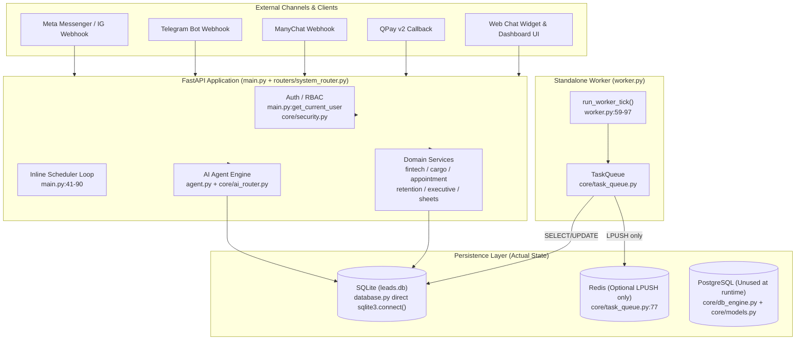

# PHASE 0 — BASELINE DISCOVERY & ARCHITECTURAL AUDIT

- **Repository:** `https://github.com/AriukagiinTuvshoo/gerege-ai-agent.git`
- **Audited Branch:** `main`
- **Audited Commit (`HEAD`):** `56f0b9aaea821260a0ef4f44b5b779aeb608fc39` (`56f0b9a`)
- **Working Tree Status:** Clean (`nothing to commit, working tree clean`)
- **Audit Date:** 2026-11-14

---

## 1. Current Architecture Diagram (Actual State at `56f0b9a`)

---

## 2. Complete API Endpoint Inventory & Authorization Map

| # | Method & Path | File & Line | Auth Helper Used | Unauthenticated Behavior (Dev) | Unauthenticated Behavior (`ENV=production`) | Tenant Scoping & Audit Status |
|---|---|---|---|---|---|---|
| 1 | `POST /api/auth/login` | `main.py:255` | Public (IP Rate Limited) | Allowed (10 req/min/IP) | Allowed (10 req/min/IP) | Sets cookie without `secure=True` in prod (`main.py:273,293`) — **P0** |
| 2 | `GET /api/auth/me` | `main.py:310` | `get_current_user` | Returns `role=guest` | Returns `role=guest` | Accepts query token in prod unless `DISALLOW_QUERY_TOKEN=1` — **P0** |
| 3 | `POST /api/auth/logout` | `main.py:337` | Cookie / Bearer | Deletes session | Deletes session | Hard-deletes row; no session revocation audit trail — **P1** |
| 4 | `GET /webhook` | `main.py:348` | `META_VERIFY_TOKEN` | Verifies challenge | Verifies challenge | Uses `==` instead of `hmac.compare_digest` (`main.py:355`) — **P1** |
| 5 | `POST /webhook` | `main.py:360` | `verify_meta_webhook_signature` | Allows if secret unset | Fail-closed (`403`) | In-memory `_PROCESSED_MIDS` lost on restart (`main.py:129`) — **P1** |
| 6 | `POST /telegram/webhook` | `main.py:434` | `verify_telegram_webhook_secret` | Allows if secret unset | Fail-closed (`403`) | Always routes to `DEFAULT_PAGE_ID` unless tenant mapped — **P1** |
| 7 | `GET /widget.js` | `main.py:502` | Public | Serves file | Serves file | Public static widget asset — **OK** |
| 8 | `POST /api/chat` | `main.py:506` | `get_current_user` (optional) | Public widget chat | Public widget chat | Scopes to `user['page_id']` if client logged in — **OK** |
| 9 | `GET/POST /api/manychat` | `main.py:536` | None | Open | Open | No webhook secret verification on `/api/manychat` — **P0** |
| 10 | `POST /api/upload-receipt` | `main.py:588` | `get_current_user` (optional) | Open for chat users | Open for chat users | No file size limit or MIME validation before `file.read()` (`main.py:607`) — **P1** |
| 11 | `GET /api/pages` | `main.py:623` | `get_current_user` | Returns masked public list | Returns masked public list | Secrets masked, but unauthenticated callers can enumerate tenants — **P0** |
| 12 | `GET /api/pages/{page_id}` | `main.py:644` | `get_current_user` | Returns masked page | Returns masked page | Unauthenticated caller can read tenant `knowledge_json` (`main.py:654`) — **P0** |
| 13 | `POST /api/pages` | `main.py:663` | `get_current_user` (`admin`) | `401` if unauth | `401` if unauth | Properly requires `admin` — **OK** |
| 14 | `DELETE /api/pages/{page_id}` | `main.py:704` | `get_current_user` (`admin`) | `401` if unauth | `401` if unauth | Deletes 4 tables, orphans 6 tenant tables (`invoices`, `cargo_packages`, etc.) — **P1** |
| 15 | `POST /api/pages/{page_id}/gemini_key` | `main.py:727` | `get_current_user` | `401` if unauth | `401` if unauth | Checks client `page_id` match — **OK** |
| 16 | `POST /api/pages/{page_id}/credentials` | `main.py:754` | `get_current_user` (`admin`) | `401` if unauth | `401` if unauth | Properly requires `admin` — **OK** |
| 17 | `GET /api/sessions` | `main.py:781` | `get_current_user` | Falls back to `DEFAULT_PAGE_ID` | Falls back to `DEFAULT_PAGE_ID` (`main.py:792`) | **P0: Unauthenticated caller gets `DEFAULT_PAGE_ID` sessions even in prod!** |
| 18 | `GET /api/sessions/{sender_id}/messages` | `main.py:796` | `get_current_user` | Returns messages | Returns messages (`main.py:802`) | **P0: Unauthenticated caller can read any `sender_id` conversation!** |
| 19 | `POST /api/sessions/{sender_id}/takeover` | `main.py:811` | `resolve_current_user` | Allows if dev | `401` in prod | If `msgs` is empty in dev, no ownership check — **P1** |
| 20 | `POST /api/sessions/{sender_id}/send` | `main.py:823` | `resolve_current_user` | Allows if dev | `401` in prod | Requires auth in prod — **P1** |
| 21 | `GET /api/registrations`, `/api/leads` | `main.py:853` | `get_current_user` | Falls back to `DEFAULT_PAGE_ID` | Falls back to `DEFAULT_PAGE_ID` (`main.py:865`) | **P0: Unauthenticated caller gets `DEFAULT_PAGE_ID` leads in prod!** |
| 22 | `POST /api/leads/{lead_id}/status` | `main.py:869` | `resolve_current_user` | Checks ownership if client | `401` in prod | Returns 200 even if `lead_id` does not exist when unauth in dev — **P1** |
| 23 | `GET /api/export/csv` | `main.py:882` | `get_current_user` | Falls back to `DEFAULT_PAGE_ID` | Falls back to `DEFAULT_PAGE_ID` (`main.py:899`) | **P0: Unauthenticated caller can export `DEFAULT_PAGE_ID` CSV in prod!** |
| 24 | `GET /api/export/excel` | `main.py:914` | `get_current_user` | Falls back to `DEFAULT_PAGE_ID` | Falls back to `DEFAULT_PAGE_ID` (`main.py:931`) | **P0: Unauthenticated caller can export `DEFAULT_PAGE_ID` Excel in prod!** |
| 25 | `POST /api/pages/{page_id}/google_sheets` | `main.py:947` | `get_current_user` | `401` if unauth | `401` if unauth | SSRF validated in `sheets_service.py`, but not on save (`main.py:959`) — **P1** |
| 26 | `GET/POST/DELETE /api/pages/{page_id}/sheets*` | `main.py:989-1133` | `get_current_user` | `401` if unauth | `401` if unauth | Properly checks auth & tenant match — **OK** |
| 27 | `GET /api/knowledge` | `main.py:1172` | `get_current_user` | Falls back to `DEFAULT_PAGE_ID` | Falls back to `DEFAULT_PAGE_ID` (`main.py:1178`) | **P0: Unauthenticated caller reads tenant knowledge in prod** |
| 28 | `POST /api/knowledge` | `main.py:1188` | `get_current_user` | Falls back to `DEFAULT_PAGE_ID` | Falls back to `DEFAULT_PAGE_ID` (`main.py:1194`) | **P0 CRITICAL: Unauthenticated user can overwrite `knowledge.json` & DB!** |
| 29 | `GET /api/health` | `main.py:1219` | Public | Returns counts | Returns counts | Queries all leads/sessions on every healthcheck (`main.py:1222-1224`) — **P2** |
| 30 | `POST /api/update-keys` | `main.py:1236` | `get_current_user` (`admin`) | `401` if unauth | `401` if unauth | Writes plaintext `.env` to disk (`main.py:1275`) — **P1** |
| 31 | `GET /pay/{invoice_id}` | `main.py:1286` | Public (Invoice capability URL) | Renders payment page | Renders payment page | Public customer payment page — **OK** |
| 32 | `GET /api/fintech/invoices/{id}/status` | `main.py:1313` | Public (Invoice polling) | Returns invoice status | Returns invoice status | Returns full `inv` dict including `sender_id` (`main.py:1321`) — **P1** |
| 33 | `GET/POST /api/fintech/qpay/callback` | `main.py:1328` | QPay provider check | Allows unverified if no QPay creds | Requires live QPay check | Does not pass `expected_amount=inv['amount']` (`main.py:1357`) — **P0** |
| 34 | `POST /api/fintech/invoices/{id}/simulate-pay` | `main.py:1364` | Admin in prod, open in dev | Marks invoice paid | Requires admin in prod | Should verify tenant ownership when non-admin in dev/staging — **P1** |
| 35 | `GET /api/fintech/summary` | `main.py:1377` | `get_current_user` | `401` if unauth | `401` if unauth | Admin cannot pass `?page_id=` filter (`main.py:1387`) — **P2** |
| 36 | `GET /api/fintech/invoices` | `main.py:1390` | `get_current_user` | `401` if unauth | `401` if unauth | Admin cannot pass `?page_id=` filter (`main.py:1404`) — **P2** |
| 37 | `POST /api/fintech/settings` | `main.py:1407` | `get_current_user` | `401` if unauth | `401` if unauth | Properly checks auth and tenant ownership — **OK** |
| 38 | `POST /api/fintech/create-invoice` | `main.py:1435` | `get_current_user` | `401` if unauth | `401` if unauth | Client can pass another tenant's `payload["page_id"]` (`main.py:1448`)! — **P0 IDOR** |
| 39 | `POST /api/cargo/scan` | `main.py:1476` | `enforce_tenant_scope` | Scoped | `401` if unauth in prod | Properly uses `enforce_tenant_scope` — **OK** |
| 40 | `POST /api/cargo/{code}/deliver` | `main.py:1495` | `enforce_tenant_scope` | Scoped | `401` if unauth in prod | Properly uses `enforce_tenant_scope` — **OK** |
| 41 | `GET /api/cargo/packages` | `main.py:1502` | `get_current_user` | Falls back to `DEFAULT_PAGE_ID` | Falls back to `DEFAULT_PAGE_ID` (`main.py:1514`) | **P0: Unauthenticated caller gets `DEFAULT_PAGE_ID` cargo list in prod!** |
| 42 | `GET /api/cargo/summary` | `main.py:1517` | `get_current_user` | Falls back to `DEFAULT_PAGE_ID` | Falls back to `DEFAULT_PAGE_ID` (`main.py:1525`) | **P0: Unauthenticated caller gets `DEFAULT_PAGE_ID` cargo summary in prod!** |
| 43 | `POST /api/cargo/import-manifest` | `main.py:1528` | `get_current_user` | `401` if unauth | `401` if unauth | Admin cannot target specific `page_id` — **P2** |
| 44 | `GET /api/executive/preview` | `main.py:1548` | `get_current_user` | Falls back to `DEFAULT_PAGE_ID` | Falls back to `DEFAULT_PAGE_ID` (`main.py:1559`) | **P0: Unauthenticated caller views executive revenue report in prod!** |
| 45 | `POST /api/executive/send-report` | `main.py:1564` | `get_current_user` | Falls back to `DEFAULT_PAGE_ID` | Falls back to `DEFAULT_PAGE_ID` (`main.py:1572`) | **P0: Unauthenticated caller can send executive report to arbitrary `chat_id`!** |
| 46 | `GET /api/executive/settings` | `main.py:1578` | `get_current_user` | Falls back to `DEFAULT_PAGE_ID` | Falls back to `DEFAULT_PAGE_ID` (`main.py:1586`) | **P0: Unauthenticated caller reads manager chat ID in prod!** |
| 47 | `POST /api/executive/settings` | `main.py:1598` | `get_current_user` | Falls back to `DEFAULT_PAGE_ID` | Falls back to `DEFAULT_PAGE_ID` (`main.py:1606`) | **P0 CRITICAL: Unauthenticated caller can hijack `telegram_manager_chat_id`!** |
| 48 | `GET /api/retention/rules` | `main.py:1628` | `get_current_user` | Falls back to `DEFAULT_PAGE_ID` | Falls back to `DEFAULT_PAGE_ID` (`main.py:1636`) | **P0: Unauthenticated access in prod** |
| 49 | `POST /api/retention/rules` | `main.py:1640` | `get_current_user` | Falls back to `DEFAULT_PAGE_ID` | Falls back to `DEFAULT_PAGE_ID` (`main.py:1648`) | **P0 CRITICAL: Unauthenticated caller can overwrite retention templates!** |
| 50 | `POST /api/retention/broadcast` | `main.py:1666` | `get_current_user` | Falls back to `DEFAULT_PAGE_ID` | Falls back to `DEFAULT_PAGE_ID` (`main.py:1674`) | **P0 CRITICAL: Unauthenticated caller can spam all customers via Broadcast!** |
| 51 | `GET /api/retention/campaigns` | `main.py:1692` | `get_current_user` | Falls back to `DEFAULT_PAGE_ID` | Falls back to `DEFAULT_PAGE_ID` (`main.py:1700`) | **P0: Unauthenticated access in prod** |
| 52 | `GET /api/retention/summary` | `main.py:1703` | `get_current_user` | Falls back to `DEFAULT_PAGE_ID` | Falls back to `DEFAULT_PAGE_ID` (`main.py:1711`) | **P0: Unauthenticated access in prod** |
| 53 | `POST /api/retention/trigger-checks` | `main.py:1714` | None | Open | Open (`main.py:1715`) | **P0: Completely unauthenticated trigger endpoint!** |
| 54 | `GET /api/appointments` | `main.py:1724` | `get_current_user` | Falls back to `DEFAULT_PAGE_ID` | Falls back to `DEFAULT_PAGE_ID` (`main.py:1737`) | **P0: Unauthenticated caller reads customer appointments & phones in prod!** |
| 55 | `POST /api/appointments` | `main.py:1741` | `get_current_user` | Falls back to `DEFAULT_PAGE_ID` | Falls back to `DEFAULT_PAGE_ID` (`main.py:1749`) | **P0: Unauthenticated caller or cross-tenant client can book arbitrary `page_id`!** |
| 56 | `POST /api/appointments/{id}/status` | `main.py:1774` | `resolve_current_user` | Checks ownership if client | `401` in prod | Properly uses `verify_resource_tenant_ownership` — **OK** |
| 57 | `GET /api/appointments/summary` | `main.py:1787` | `get_current_user` | Falls back to `DEFAULT_PAGE_ID` | Falls back to `DEFAULT_PAGE_ID` (`main.py:1795`) | **P0: Unauthenticated access in prod** |
| 58 | `POST /api/chat/voice` | `main.py:1801` | Public chat endpoint | Open | Open | Missing audio upload byte size limit (`main.py:1815`) — **P1** |
| 59 | `GET/POST /api/admin/backups*` | `routers/system_router.py:12-45` | `Depends(require_admin)` | `401`/`403` | `401`/`403` | Properly requires admin — **OK** |
| 60 | `GET /api/admin/metrics` | `routers/system_router.py:48` | `Depends(require_admin)` | `401`/`403` | `401`/`403` | Properly requires admin — **OK** |
| 61 | `POST /api/admin/queue/process` | `routers/system_router.py:54` | `Depends(require_admin)` | `401`/`403` | `401`/`403` | Properly requires admin — **OK** |

---

## 3. Database Connection Map & Schema Discrepancies

### 3.1 Split-Brain Database Architecture (P0)
- `core/db_engine.py` defines `get_database_url()` and `create_sqlalchemy_engine()` supporting PostgreSQL (`postgresql+psycopg2://`) and SQLite (`sqlite:///leads.db`).
- **However**, `database.py` (61 functions) and `core/task_queue.py` (4 methods) hardcode `sqlite3.connect(DB_PATH)`!
- Consequently, if `DATABASE_URL=postgresql://...` is configured in production (`docker-compose.prod.yml:41`), Alembic connects to PostgreSQL, while FastAPI (`main.py`), `agent.py`, `worker.py`, and all domain services read and write to an ephemeral local SQLite file (`leads.db`) inside the container!

### 3.2 Schema Mismatches Between `database.py` and `core/models.py` (P0)
1. **Table Name Mismatch #1:** `database.py:140` creates table `user_memories` (with column `last_topic`), whereas `core/models.py:107` defines `__tablename__ = "user_memory"` (with `preferences`, `interaction_count`, `last_seen`, missing `last_topic` and `updated_at`).
2. **Table Name Mismatch #2:** `database.py:157` creates table `invoices` (with `id INTEGER PRIMARY KEY AUTOINCREMENT` and `invoice_id TEXT UNIQUE NOT NULL`), whereas `core/models.py:127` defines `__tablename__ = "payment_invoices"`.
3. **`session_states` Missing Columns in `core/models.py`:** `database.py:116` has `channel`, `customer_name`, `customer_phone` in `session_states`; `core/models.py:87` only has `sender_id`, `page_id`, `is_human_takeover`, `updated_at`.
4. **`cargo_packages` Missing Column in `core/models.py`:** `database.py:193` has `notified_at TIMESTAMP`; `core/models.py:149` omits `notified_at`.
5. **Alembic Initial Migration (`migrations/versions/0001_initial_enterprise_schema.py:19`):** Calls `Base.metadata.create_all(bind=bind)` instead of explicit Alembic `op.create_table` / `op.create_index` operations.
6. **Missing PostgreSQL Driver in `requirements.txt`:** `requirements.txt` does not list `psycopg2-binary` or `redis`.

---

## 4. Background Worker, Scheduler & Task Queue Flow

- **Inline vs Standalone Scheduler:** `main.py:82` starts `executive_scheduler_loop()` unless `DISABLE_INLINE_SCHEDULER=1`. Notice `Dockerfile:27` runs `uvicorn main:app --workers 2`; if `DISABLE_INLINE_SCHEDULER` is not set, both Uvicorn workers run duplicate inline schedulers.
- **Task Queue (`core/task_queue.py`) Is Not a Real Redis Queue (P0):**
  - On `enqueue()` (`core/task_queue.py:77`), it writes to SQLite `task_jobs` and then calls `self._redis.lpush("gerege:task_queue", ...)`.
  - On `process_pending_jobs()` (`core/task_queue.py:85`), it **never reads from Redis**—it only queries `sqlite3.connect(database.DB_PATH)` with a non-atomic `SELECT * FROM task_jobs WHERE status = 'PENDING'`.
  - Two concurrent workers calling `process_pending_jobs()` will select and execute the exact same `PENDING` rows simultaneously (race condition).
  - No exponential backoff schedule (`next_run_at`), no Dead-Letter Queue (`DEAD_LETTER`), no task timeout (`asyncio.wait_for`), no stale `PROCESSING` recovery on worker crash, and no `SIGTERM`/`SIGINT` graceful shutdown in `worker.py`.

---

## 5. Backup & Disaster Recovery Findings

- **PostgreSQL Restore Unimplemented (`core/backup_service.py:181`) — P1:**
  - `restore_backup()` only handles `.db.gz` (SQLite) and returns `{"success": False, "error": "Unsupported backup format for automatic restore"}` for `.sql.gz` (PostgreSQL).
- **PostgreSQL Backup Verification Incomplete (`core/backup_service.py:110`) — P1:**
  - `verify_backup()` does not test decompressing `.sql.gz` or verifying non-empty SQL dump structure.

---

## 6. External Integration Map

1. **Google Gemini (`google-genai` SDK):** `agent.py:188-223`, multimodal text/image/audio + function calling.
2. **OpenAI / Anthropic Fallbacks (`httpx`):** `core/ai_router.py:171-258`.
3. **QPay v2 (`httpx`):** `fintech_service.py:203-283` (`/v2/auth/token`, `/v2/invoice`, `/v2/payment/check`).
4. **Meta Graph API (`v22.0`):** `main.py:135-157`, `retention_service.py:55-78`.
5. **Telegram Bot API:** `main.py:159-192, 434-497`, `executive_bot_service.py:61-95`.
6. **Google Sheets CSV Export (`urllib.request`):** `sheets_service.py:15-85` (restricted to `docs.google.com`).

---

## 7. Test Inventory & CI/CD Findings

- **Existing Tests:**
  - `tests/test_enterprise_phases.py` (11 unit/integration tests covering Phases 1–5).
  - `scratch/test_security_p0_e2e.py` (7 security checks).
  - `scratch/test_rbac.py` (8 RBAC checks).
  - `scratch/test_fintech_e2e.py`, `scratch/test_cargo_e2e.py`, `scratch/test_executive_e2e.py`, `scratch/test_retention_e2e.py`, `scratch/test_appointments_voice_e2e.py`.
- **CI Gaps (`.github/workflows/ci.yml`) — P0/P1:**
  - No PostgreSQL or Redis service containers in GitHub Actions.
  - No `alembic upgrade head` verification against PostgreSQL.
  - No Docker image build test in CI.

---

## 8. Prioritized Findings Summary (P0 – P3)

| ID | Severity | Component | Finding & Evidence |
|---|---|---|---|
| **F-01** | **P0** | Database (`database.py`, `core/task_queue.py`, `core/models.py`) | Application uses hardcoded `sqlite3.connect(DB_PATH)` across 65+ call sites even when `DATABASE_URL` points to PostgreSQL, and `core/models.py` table names (`user_memory`, `payment_invoices`) do not match `database.py` (`user_memories`, `invoices`). |
| **F-02** | **P0** | Auth & Tenant Isolation (`main.py:623-1796`) | 22 API endpoints use legacy `get_current_user` and silently fall back to `database.DEFAULT_PAGE_ID` when unauthenticated (even in production), exposing leads, sessions, messages, exports, cargo, appointments, executive reports, and allowing unauthenticated writes to `/api/knowledge`, `/api/executive/settings`, `/api/retention/rules`, and `/api/retention/broadcast`. |
| **F-03** | **P0** | Cross-Tenant IDOR (`main.py:1448, 1606, 1648, 1674, 1737, 1749`) | In `POST /api/fintech/create-invoice` (`main.py:1448`) and `GET /api/appointments` (`main.py:1737`), `payload.get("page_id")` takes precedence over `user.get("page_id")` or allows unverified tenant overrides. |
| **F-04** | **P0** | Auth Cookies & Query Tokens (`main.py:273,293`, `core/security.py:47`) | Session cookies lack `secure=True` in production, and query-string tokens (`?token=...`) are accepted in production unless `DISALLOW_QUERY_TOKEN=1` is set. |
| **F-05** | **P0** | QPay Verification (`main.py:1357`, `fintech_service.py:251,377`) | `qpay_webhook_callback` does not pass `expected_amount=inv["amount"]` to `check_qpay_payment_live()`, does not record provider transaction IDs or replay locks, and `create_payment_order_sync` bypasses live QPay even when credentials are configured. |
| **F-06** | **P0** | Task Queue (`core/task_queue.py:77-141`) | Redis only receives `LPUSH`; workers never consume from Redis and perform non-atomic `SELECT` polling on SQLite without atomic claiming, backoff scheduling, dead-letter queue, task timeout, or crash recovery. |
| **F-07** | **P1** | Backup & Restore (`core/backup_service.py:110-181`) | PostgreSQL `.sql.gz` restore is unimplemented (`Unsupported backup format for automatic restore`) and `.sql.gz` verification only checks SHA-256. |
| **F-08** | **P1** | RBAC Roles & Session Revocation (`core/security.py`, `database.py`) | Only `admin` and `client` roles exist; granular roles (`super_admin`, `admin`, `manager`, `agent`, `warehouse_staff`, `client`, `read_only`), permission matrix enforcement, and session revocation are missing. |
| **F-09** | **P1** | AI Safety & Privacy (`core/ai_router.py`, `agent.py`) | Missing provider circuit breaker, structured tool audit log, and user memory/data deletion (`Бүртгэл устгах`) workflow promised in `/privacy`. |
| **F-10** | **P1** | CI/CD (`.github/workflows/ci.yml`) | CI workflow lacks real PostgreSQL and Redis service containers, Alembic migration verification, and Docker build validation. |
